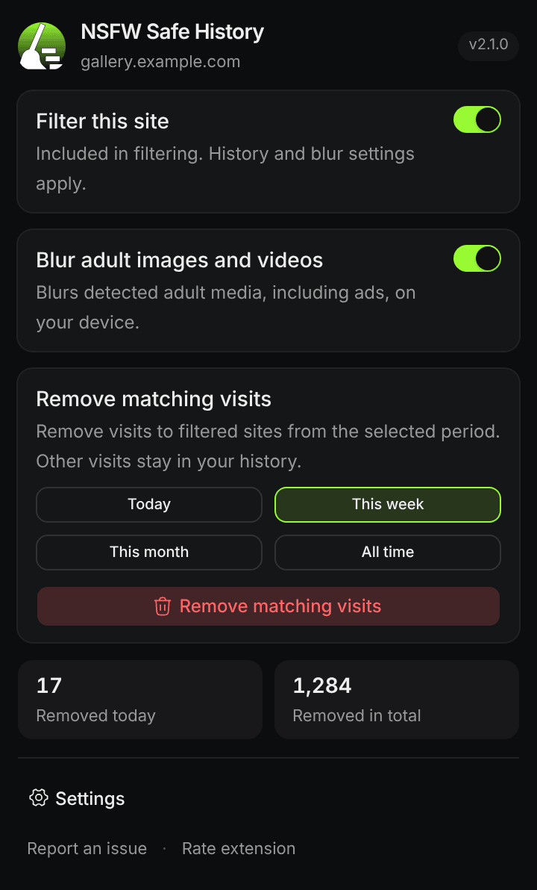
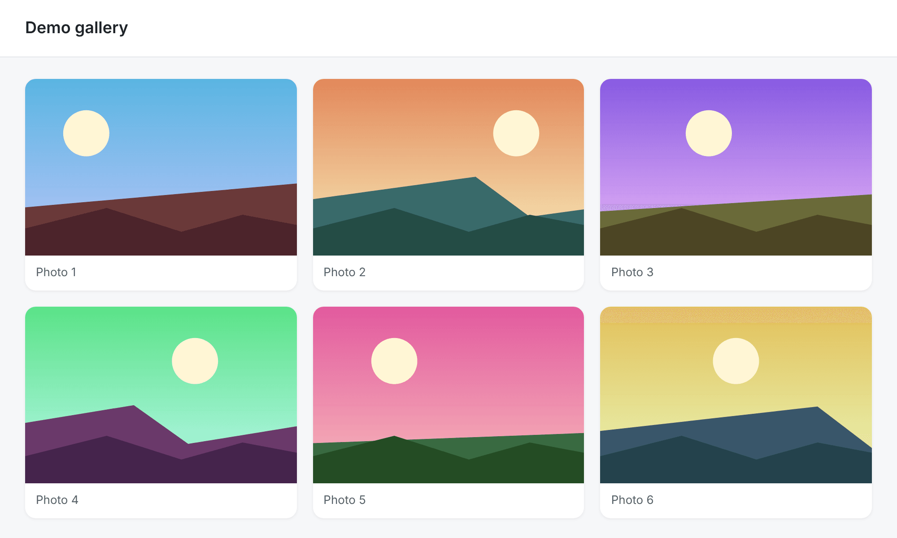
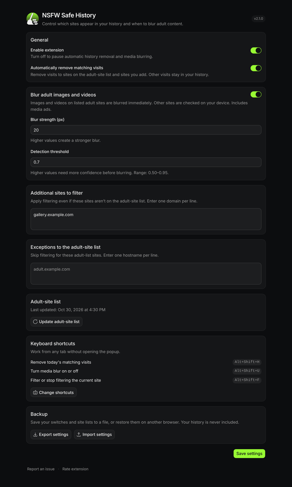
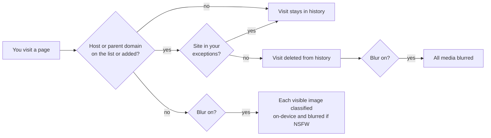

<div align="center">


# NSFW Safe History

**Keep adult sites out of your browser history, and blur NSFW images on your own device.**

[](https://microsoftedge.microsoft.com/addons/detail/nsfw-safe-history/ajhlgoaigfcfjlhmkghchilnponmdfoa)
[](https://github.com/artechio/NSFW-Safe-History/releases/latest)
[](https://github.com/artechio/NSFW-Safe-History/actions/workflows/build-extension.yml)
[](LICENSE)

[Install](#install) · [Features](#features) · [Privacy](#privacy) · [Build from source](#build-from-source) · [Changelog](CHANGELOG.md)

</div>

---

<table>
<tr>
<td width="36%" valign="top">

</td>
<td valign="top">

### What it does

- **Removes adult visits from history as they happen.** Each visit is checked against an on-device list of about 75,000 adult domains, and matches are deleted right away.
- **Cleans up past visits** from today, this week, this month, or all time.
- **Blurs NSFW images and videos.** A small MobileNet model runs inside the browser to classify them. Pixels never leave your machine.
- **You decide which sites count.** Add sites to filter, or make exceptions to the list, in one click from the popup.

Works in Microsoft Edge, Chrome, Brave, Opera, Vivaldi and other Chromium browsers (Manifest V3).

</td>
</tr>
</table>

## Install

| Where | How |
| --- | --- |
| **Microsoft Edge Add-ons** (recommended) | [Get it from the store](https://microsoftedge.microsoft.com/addons/detail/nsfw-safe-history/ajhlgoaigfcfjlhmkghchilnponmdfoa). Updates are automatic. |
| **GitHub Release** (any Chromium browser) | Download `nsfw-safe-history-*.zip` from the [latest release](https://github.com/artechio/NSFW-Safe-History/releases/latest) and unzip it. Open `edge://extensions` or `chrome://extensions`, turn on **Developer mode**, click **Load unpacked**, and pick the folder that contains `manifest.json`. |

## Features

### On-device media blur

Blur is **off by default**. Turn it on from the popup or with <kbd>Alt</kbd>+<kbd>Shift</kbd>+<kbd>U</kbd>.

- **On sites you filter:** every image, video and media ad is blurred straight away.
- **On other sites:** visible media is classified locally, and blurred only when the `Porn` or `Hentai` score reaches your threshold. `Sexy` alone never triggers a blur.
- **To reveal one item:** click it.

| Blur off | Blur on (filtered site) |
| --- | --- |
|  |  |

<sub>The demo uses placeholder landscapes on a test site added to the filter list.</sub>

### History cleanup

- **Automatic:** visits to listed or added sites, and their subdomains, are removed as you browse.
- **Filter this site:** switching it on also removes your earlier visits to that site.
- **Manual clean:** removes matching visits for a chosen period. Everything else stays in your history.
- **Removal stats:** the popup shows how many visits were removed today and in total. The numbers are kept only on this device.
- **Toolbar badge:** a small dot shows that the current tab is filtered, without naming why. `OFF` shows while the extension is paused.

### Settings



- **Blur strength** (5–40 px) and **detection threshold** (0.50–0.95).
- **Additional sites to filter:** sites that aren't on the list but should be treated as if they were.
- **Exceptions:** sites on the list that you want left alone.
- **Backup:** export your switches and site lists to JSON and import them on another browser. History is never included.
- **Captcha-safe:** reCAPTCHA, hCaptcha, Cloudflare Turnstile and similar challenges are never blurred.

### Keyboard shortcuts

| Shortcut | Action |
| --- | --- |
| <kbd>Alt</kbd>+<kbd>Shift</kbd>+<kbd>U</kbd> | Turn media blur on or off |
| <kbd>Alt</kbd>+<kbd>Shift</kbd>+<kbd>F</kbd> | Filter or stop filtering the current site |
| <kbd>Alt</kbd>+<kbd>Shift</kbd>+<kbd>H</kbd> | Remove today's matching visits |

To change them, open **Settings → Keyboard shortcuts → Change shortcuts**, or go to `edge://extensions/shortcuts`.

## Privacy

- **Nothing is uploaded.** Image pixels, page contents and your history are never sent anywhere.
- **Classification is local.** It runs in an offscreen extension page using [nsfwjs](https://github.com/infinitered/nsfwjs) and TensorFlow.js. The model ships inside the extension.
- **To classify an image, the extension reads it again** from the browser cache or from the site that served it, without cookies.
- **One request of its own:** the weekly download of the public [Steven Black porn-only hosts list](https://github.com/StevenBlack/hosts). No user data is sent with it.
- **No accounts, no analytics, no ads.**

See the full [privacy policy](PRIVACY.md).

## How it works



- **Domain check:** an in-memory `Set` lookup, cached in IndexedDB. It walks up through parent domains, so `cdn.example.com` matches `example.com`.
- **History removal:** uses `chrome.history.deleteUrl`, which removes every visit to that exact URL.
- **Image checks:** at most two run at once and are cached in an LRU. Captcha frames and widgets are skipped.

## Build from source

You need Node.js 20.19+ or 22.12+.

```bash
npm install
npm install --prefix ext-ui
npm test
npm run build
```

Load the `dist/` folder as an unpacked extension.

| Script | What it does |
| --- | --- |
| `npm run dev` / `npm run dev:ui` | Watch builds for the core scripts and the popup/options UI |
| `npm run update-blocklist` | Refresh `assets/blocklist.txt` from the Steven Black list |
| `npm run download-model` | Refresh the bundled MobileNet weights in `assets/model/` |
| `npm run generate-icons` | Rebuild the toolbar and light/dark icon sets from `assets/icon.svg` |

**Project layout:**

```
src/background.js     service worker: history, blocklist, badge, shortcuts, messaging
src/contentScript.js  finds media on the page and applies blur
src/offscreen.js      runs the nsfwjs model
src/lib/              pure helpers (domains, settings, stats, backup, LRU); unit-tested in test/
ext-ui/               popup and settings pages (Vite, React, Tailwind, shadcn/ui)
```

Every push to `main` builds the extension and publishes a GitHub Release with the ZIP and the matching [CHANGELOG](CHANGELOG.md) notes.

## Contributing

Bug reports and pull requests are welcome. [Open an issue](https://github.com/artechio/NSFW-Safe-History/issues) for false positives, sites that break, or feature ideas. Run `npm test` before you send a PR.

## License

MIT. See [LICENSE](LICENSE).

**Third-party:**
- Domain list: [Steven Black hosts](https://github.com/StevenBlack/hosts) (MIT)
- Classifier: [nsfwjs](https://github.com/infinitered/nsfwjs) (MIT)
